# Quantify 关键操作流程

本文件与[概要设计](README.md)、[模块架构](MODULES.md)配套。图中接口省略主机前缀；所有网页 API 都由本机 `Handler` 接收。图中的 SQLite 参与者包含对应 Store，进程通过函数和数据库交互，不存在消息中间件。

## 1. CSV 导入与月度快照

入口：工作台导入表单 → `POST /api/workspace/import`。浏览器读取 UTF-8 文件，将 CSV 文本与来源、口径等元数据作为 JSON 提交。

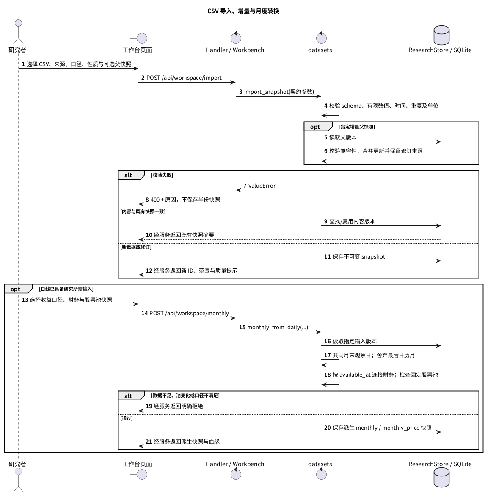

不对缺失总回报指数、财务字段或退市数据进行编造。时点查询 `POST /api/workspace/as-of` 只按声明的可用时间返回数据，不等于核验真实公告。

## 2. 报价查询、历史下载和每日调度

报价刷新和历史下载是不同通路：前者唤醒主进程行情线程，后者进入持久化工作队列。

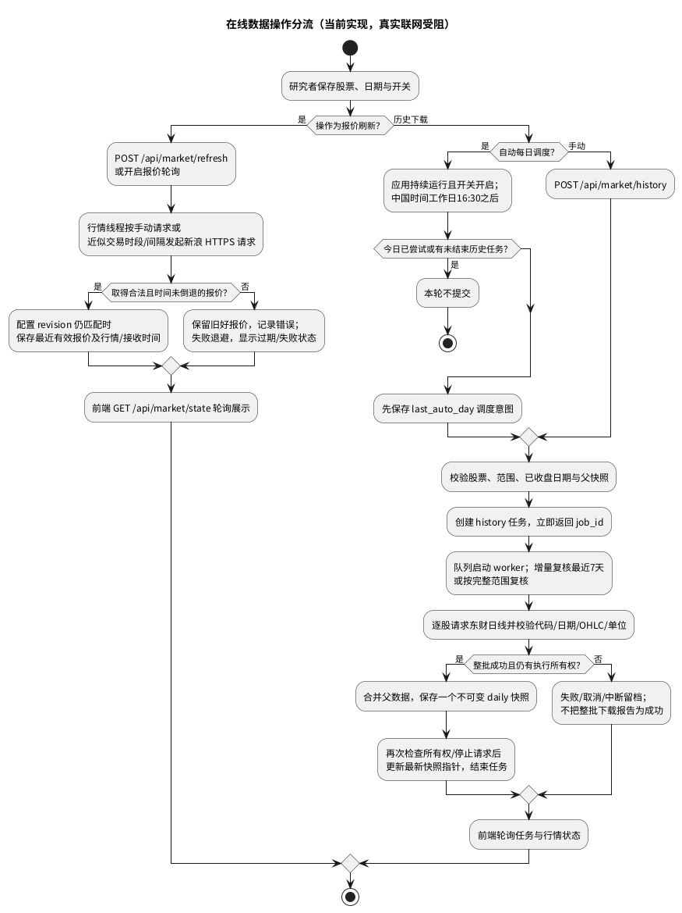

历史下载失败或停止前可能已生成不可变产物，任务状态与产物是否存在分别处理；指针更新需再次通过执行所有权和停止检查。调度持久化意图可能使故障当日不再自动尝试，显式新建重试保留历史。当前只有工作日/时段近似规则，尚无交易所节假日日历验收。日线下载之后不会自动转月度、生成信号或触发 AI 研究。

## 3. 开发实验与滚动样本外计算

页面通过 `POST /api/lab/experiments` 入队；旧同步 `/api/workspace/experiments` 保留兼容，两者最终调用同一个 `Workbench.run`。

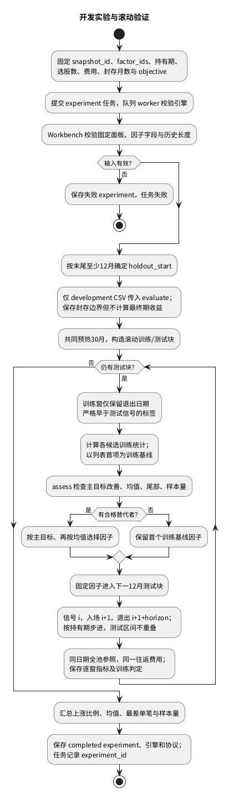

训练标签允许重叠，横截面股票收益存在相关性；测试“非重叠”不意味着所有单笔样本相互独立。比较入口固定相同快照、目标、成本、持有期、封存与测试窗口；复现要求完全相同的引擎摘要及 Python 版本。

## 4. ChatGPT / DeepSeek 手动因子迭代

本节为保留的手动流程：程序执行校验/实验/反馈，研究者在外部模型客户端获取提案。API自动模式见第10节；两种模式均不自动进入最终验证或启用。

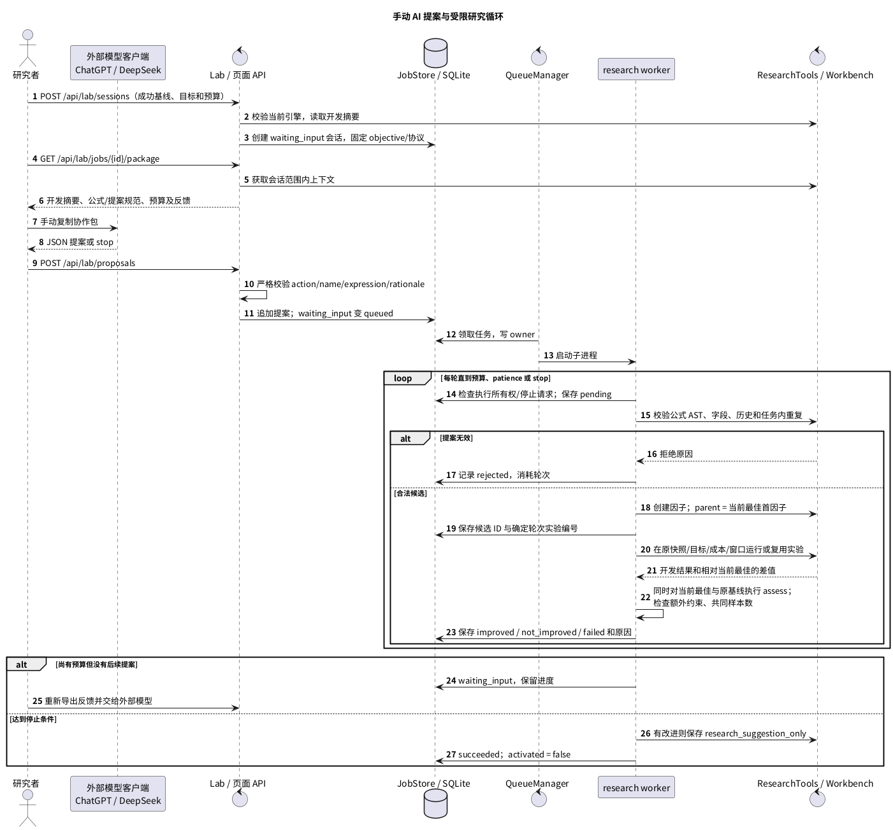

非法公式和重复公式也会计入轮次与无改进次数；候选数在合法因子建立后计数。任务预算不等于跨会话过拟合控制。协作包不含原始行情或最终期收益，工具没有任意快照读取、最终验收、启用或交易入口。

## 5. 冻结与最终验收

入口：`POST /api/strategies/freeze` → 人工决定验收 → `POST /api/strategies/evaluate`。最终期使用冻结的单因子，不再次训练或挑选。

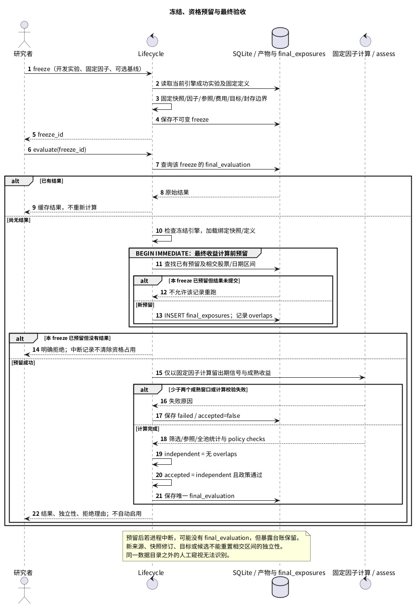

至少两个成熟非重叠窗口：3/6/12月持有期分别需要至少8/14/26月留出数据，且工作台封存下限仍为12月。最少窗口和样本门槛用于软件准入，不代表统计显著。看过最终结果再调参，需要新的未暴露数据；重测可保存探索性结果，但不能据此启用。

## 6. 人工启用、替换、退役与回滚

入口：`POST /api/strategies/change`。`activate` 在已有活跃版本时就是替换；没有单独的自动更替服务。

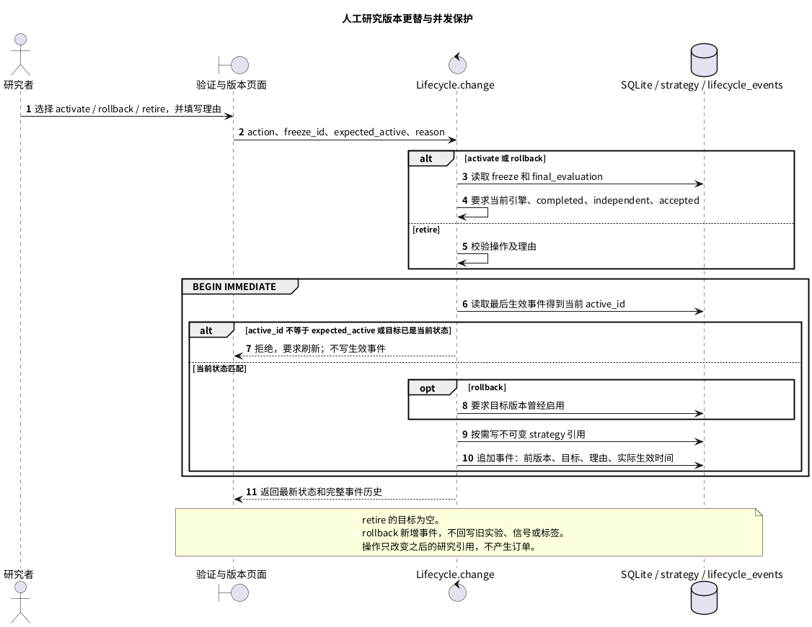

只有通过独立验收的版本可启用；合成版本保留合成标识，仅用于流程演示。退役版本的既有信号仍可更新成熟标签。

## 7. 新快照、前向信号与成熟标签

入口：`POST /api/strategies/signal`、`POST /api/strategies/observe`。两项均为研究者手动触发的同步操作。

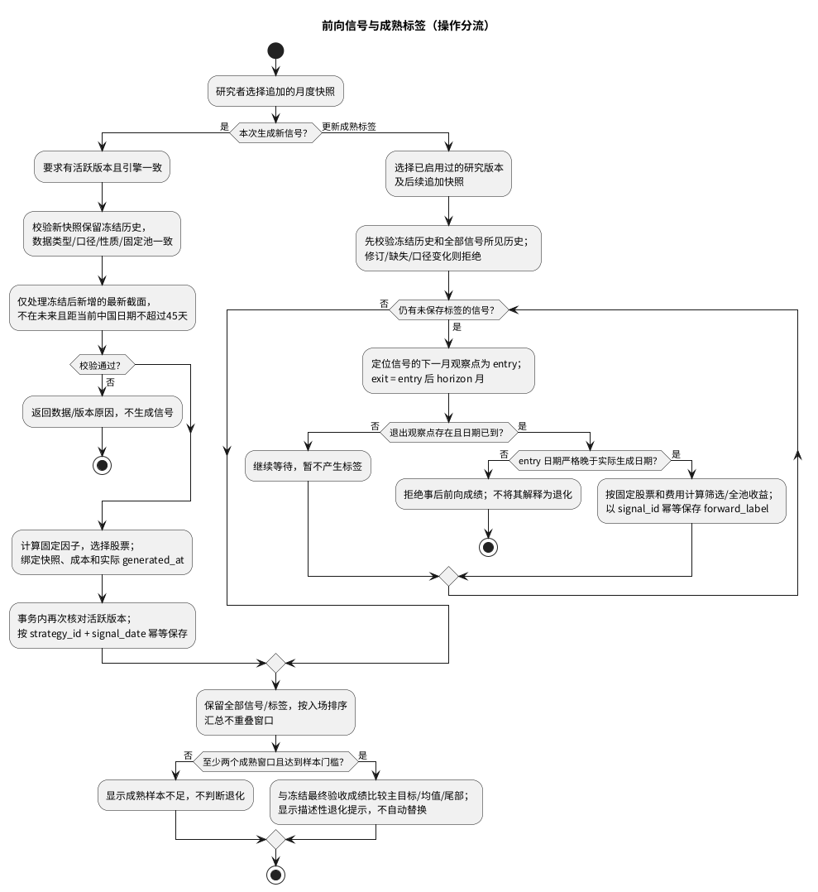

生成信号时未来观察点尚未出现，最终入场时间检查在成熟更新时完成。界面不可把已知历史收益补录成前向成绩。观察窗口不同于最终期，下降提示不等于统计显著的因子失效；数据异常需要核对或新版本验证，不能当作策略退化依据。

## 8. 暂停、取消、超时与重启恢复

任务控制入口为 `POST /api/lab/control`，新建重试为 `POST /api/lab/retry`。下图以运行中的 research 暂停为例；取消和超时使用相同的进程停止基础。

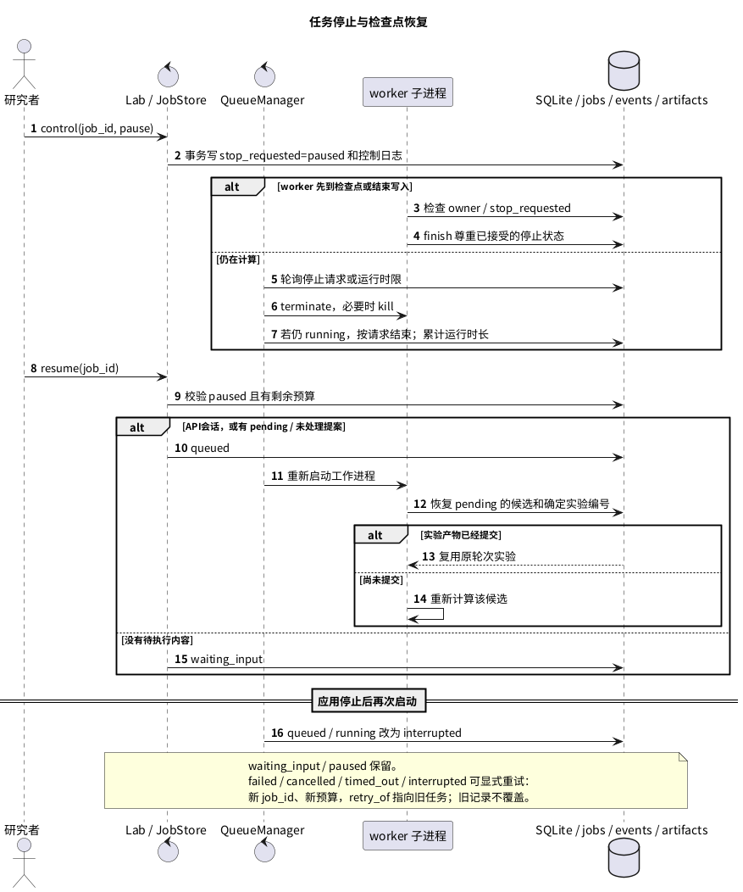

计算产物已经提交而任务未完成的情形，通过确定实验编号和检查点复用处理，不删除已存在结果。最终验收暴露台账不是任务预算；新建任务、重试或重启不能为已暴露区间重新取得独立资格。

## 9. 个股、估值与风险模拟

该流程保留最初 demo 能力，与历史因子研究的统计和数据来源分开。

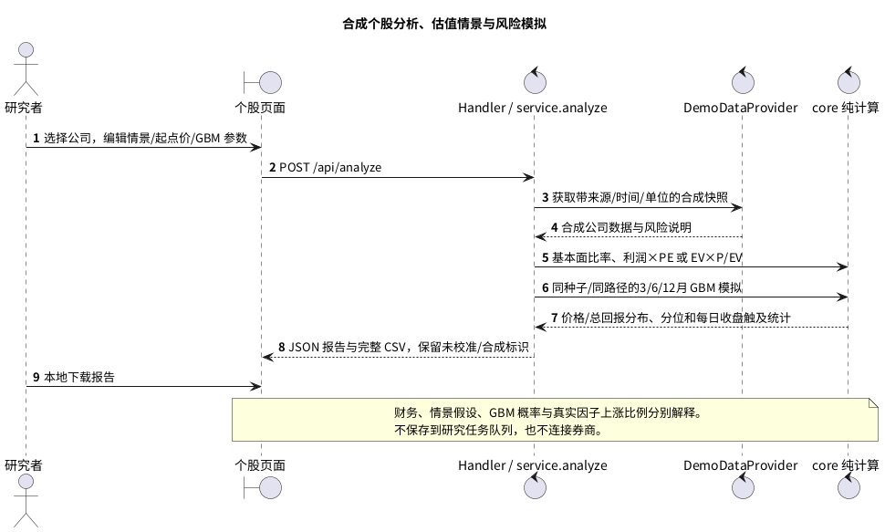

估值情景不赋予概率；GBM 触及事件相对初始投入，不是组合最大回撤。使用者修改假设后重新计算，报告保留输入及参数来源，不能据此承诺真实收益。

## 10. 模型API自动提案与调用预算

入口：研究室保存非密模型/单价配置，再以 `provider=openai|deepseek` 创建会话。API只执行受限提案请求，不是模型直接工具调用。

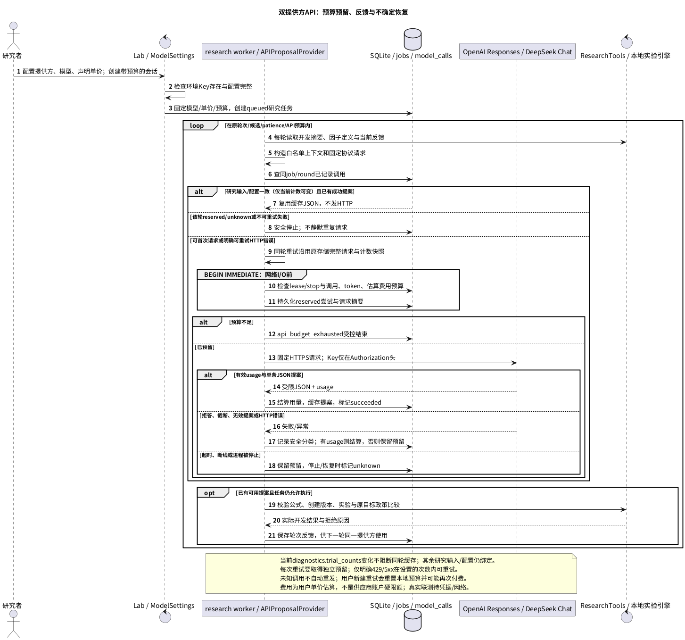

图中的停止路径会退出研究循环；只有成功提案才进入本地实验。模型输出合法JSON但公式非法时，沿用原拒绝轮次/预算规则并把反馈提供给下一轮。原始行情、最终收益、环境密钥和启用权限不进入上下文。

## 11. 组合版本与开发期回放（008）

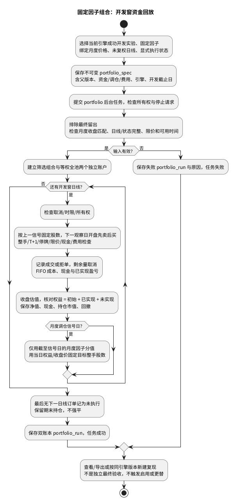

停止和所有权异常沿用工作进程退出路径，不保存不完整的成功账本。重启将未完成任务标为中断；显式重试创建新任务。合成示例、真实来源声明和未调整分红/公司行动的限制保留在报告与导出中。

## 12. 开发期因子诊断与AI反馈（009）

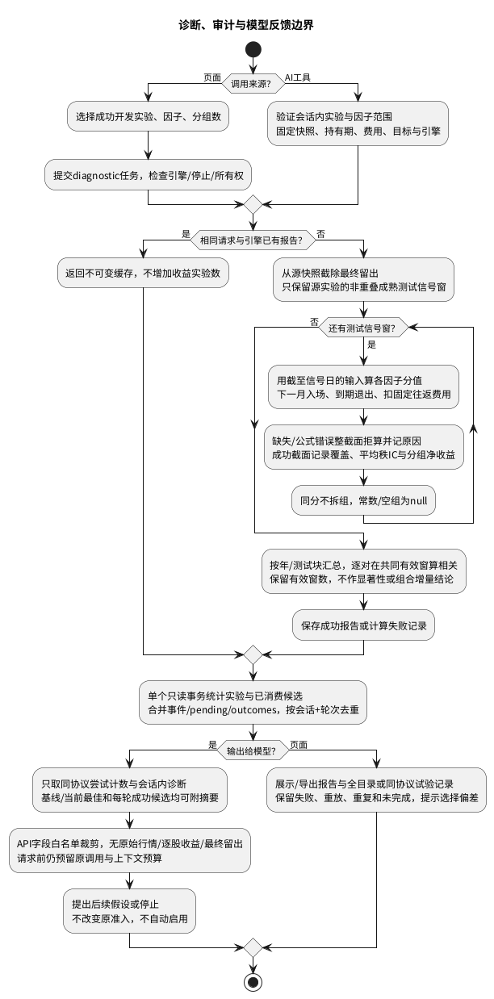

## 13. 页面异步响应与当前任务（010）

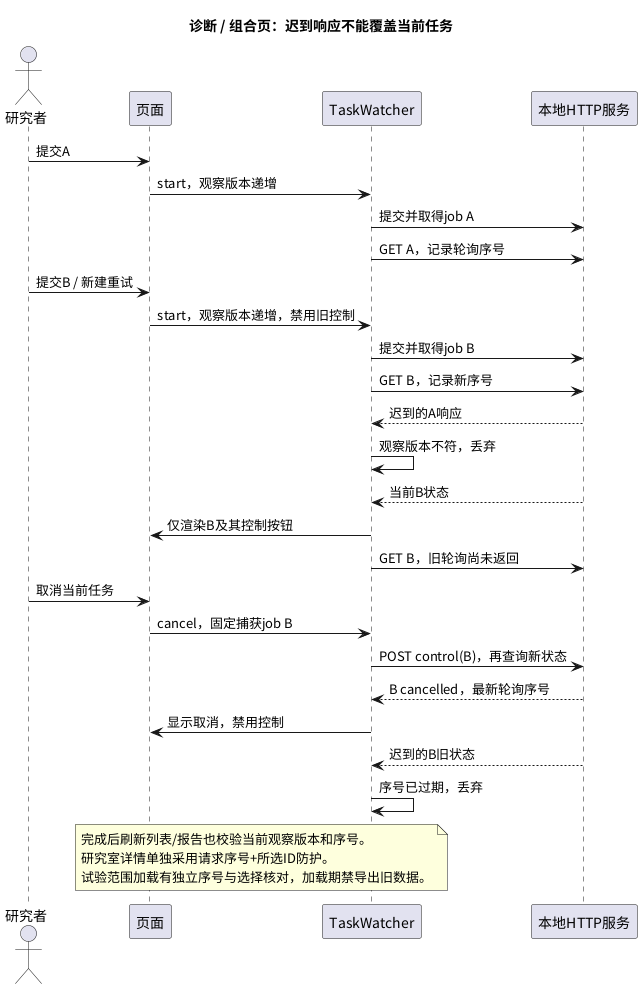

## 14. 多因子添加、移除与AI增量（011）

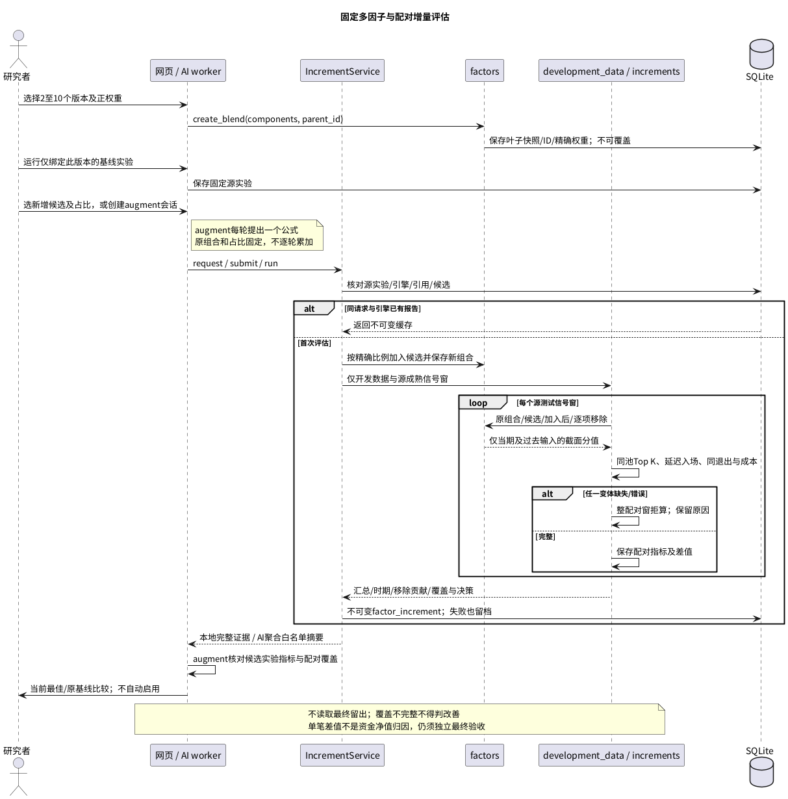

## 15. 组合冻结、独立最终回放与人工更替（012）

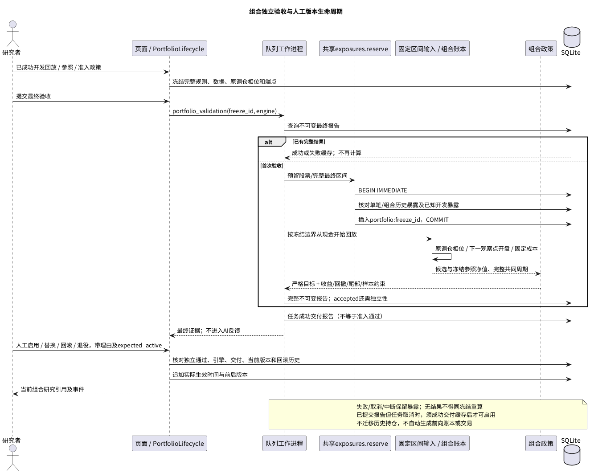
