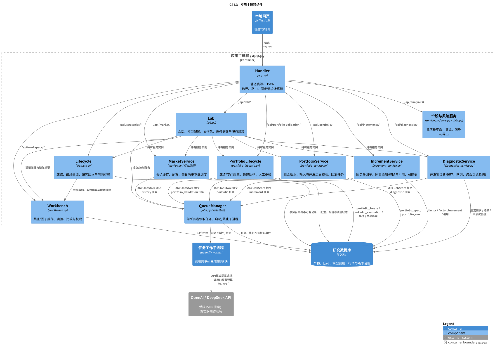
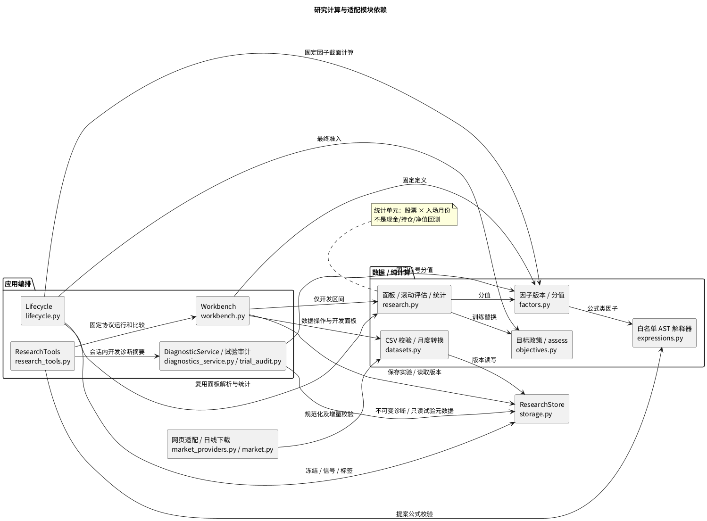
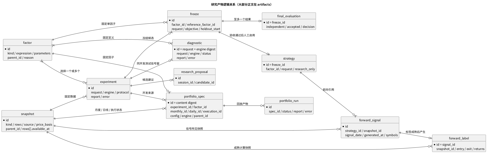
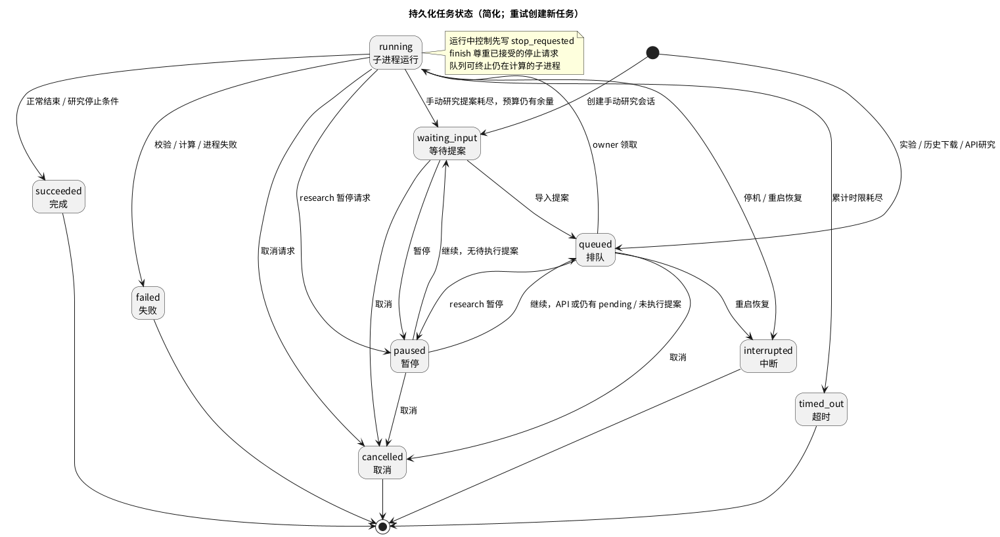
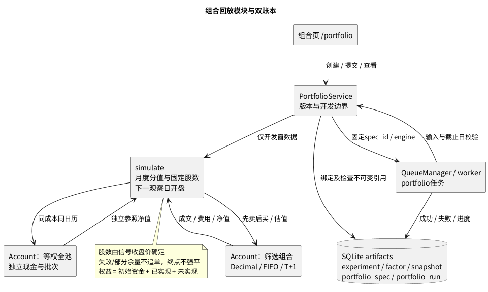
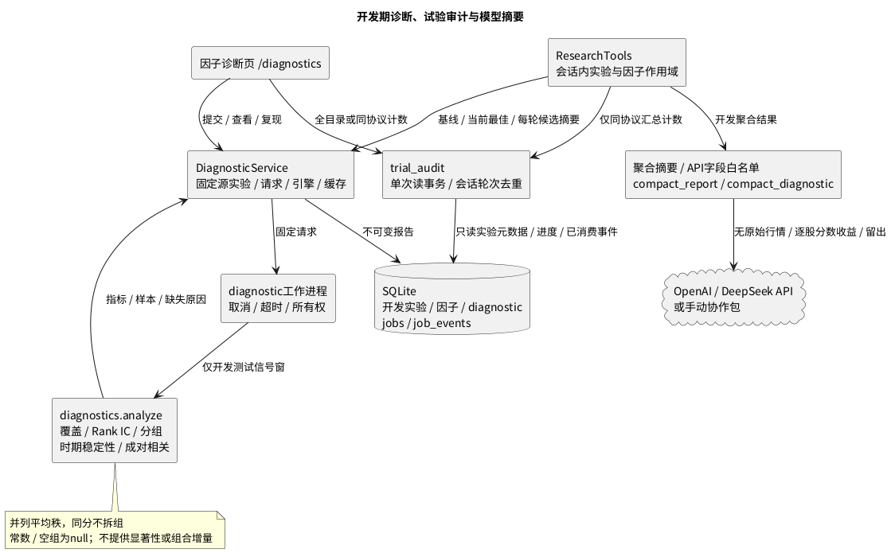
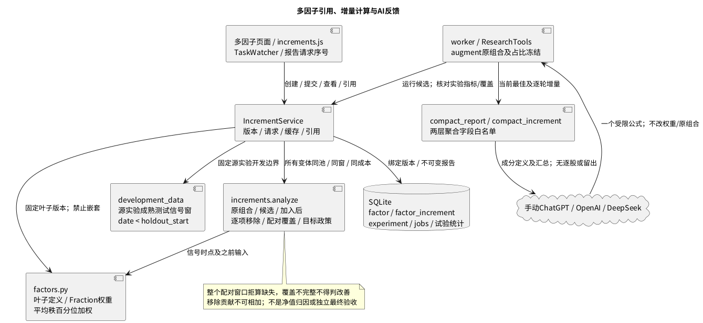
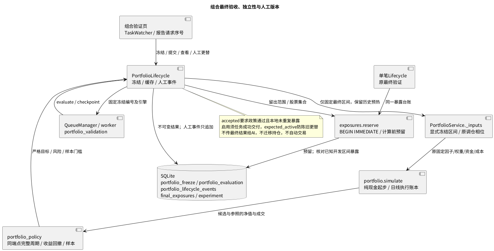

# Quantify 主要模块架构

本文件描述[概要设计](README.md)所列当前实现；组件名称对应实际 Python 模块。组件间调用是进程内函数调用，只有队列工作进程和外部行情涉及运行边界。

## 1. C4 Level 3：应用编排组件

`Handler` 按路由选择服务，`Lab` 负责组装工作台、生命周期、组合、组合生命周期、诊断、增量、队列和行情服务；图中的编排关系不表示这些服务所有请求都必须依次经过 Lab 的业务方法。

## 2. 主要模块职责与接口

| 模块 | 主要实现 | 输入 → 输出 | 关键约束 |
| --- | --- | --- | --- |
| HTTP / 静态页面 | `app.py`、`static/*` | HTTP/JSON → 页面、任务编号、结果 | 本机监听；Content-Type/大小/有限数值校验；同源 CSP；前端轮询而非 WebSocket |
| 不可变存储 | `storage.py: ResearchStore` | 产物正文 → 版本记录 | 同 `(kind,id)` 不可覆盖；快照、因子、冻结记录和组合版本校验内容摘要 |
| 数据中心 | `datasets.py` | CSV/父快照 → 新快照、质量提示、时点查询 | 六类 schema；增量幂等、修订新版本；财务 available_at 与报告期分离 |
| 在线适配 | `market_providers.py` | 固定 HTTPS 响应 → 规范化报价/日线 | 新浪 GBK 严格解析、东财 JSON/单位转换；响应脚本不执行；有限重试 |
| 行情编排 | `market.py` | 配置/日期/股票 → 报价缓存或 history 任务 | 旧好报价保留；时间倒退与过期提示；每日意图先持久化再提交 |
| 因子与公式 | `factors.py`、`expressions.py` | 因子定义 + 历史面板 → 截面分值 | 版本不可变；窗口只看过去；AST 白名单及复杂度/数值边界 |
| 组合最终验证 | `portfolio_lifecycle.py`、`portfolio_policy.py`、`exposures.py` | 完整冻结+留出 → 现金起步账本/政策与人工事件 | 与单笔共用预留；检查开发暴露；最终结果不进入AI |
| 多因子增量 | `factors.py`、`increments.py`、`increment_service.py` | 固定版本/权重与开发窗 → 配对/移除报告、引用 | 不嵌套；Fraction权重；整窗配对拒算；不是净值归因 |
| 研究计算 | `research.py` | 开发面板、因子、费用、目标 → 分窗单笔统计 | 标签成熟、延迟入场、共同窗口；固定池，不核算组合资金 |
| 因子诊断 | `diagnostics.py`、`diagnostics_service.py`、`trial_audit.py` | 固定开发实验/因子 → 诊断、重复/尝试计数 | 截除留出，同信号窗；并列/常数/缺失可见；模型摘要受作用域与白名单限制 |
| 组合回放 | `portfolio_service.py`、`portfolio.py` | 版本/日线/状态 → 双账本/净值/成交 | 仅开发窗；信号股数冻结、整手/T+1、FIFO对账；不继承最终准入 |
| 目标政策 | `objectives.py` | 候选/参照统计 + policy → checks/reasons | 训练替换、研究准入、最终验收共用 `assess` |
| 工作台服务 | `workbench.py` | 固定快照/因子/协议 → experiment、比较、复现 | 切除留出期后计算；成功与失败留档；比较必须同协议；复现须同引擎 |
| 持久化任务 | `jobs.py`、`worker.py` | experiment/research/history/portfolio/diagnostic → 状态、进度、结果 | 单队列所有者；工作进程检查 owner；接受停止请求后不能被成功覆盖 |
| 模型API | `model_api.py`、`model_calls.py` | 开发摘要 → 提案/用量/调用台账 | 固定HTTPS端点、环境密钥、每次调用先预留、未知结果不静默重发 |
| AI 协作 | `lab.py`、`research_tools.py`、`proposals.py` | 开发摘要/JSON 提案 → 因子、实验、反馈、建议 | 手动/API共用会话范围内工具；无原始行情/最终收益工具；预算；不启用版本 |
| 研究生命周期 | `lifecycle.py` | 开发实验/追加快照/人工决定 → freeze/final/strategy/signal/label | 暴露预留、人工生效、未来入场、成熟与非重叠统计 |
| 个股与模拟 | `data.py`、`core.py`、`service.py` | 合成公司快照、主观情景及 GBM 参数 → 报告/导出 | 与因子研究面板分离；不把主观模拟概率称为真实上涨胜率 |

所有服务通过同一个数据目录中的 SQLite 文件共享状态。`JobStore`、`MarketStore` 扩展 `ResearchStore`，`Lifecycle` 在共享存储上维护自身台账；这里没有 ORM、消息中间件或外部数据库服务。

## 3. 研究计算内部架构

下图为包/函数依赖视图，补充 C4 编排视图中的纯计算和适配模块。

### 3.1 数据与时间边界

- `daily` 保存 OHLC、成交量、可选总回报指数；`monthly` 使用含分红再投资指数，`monthly_price` 使用未复权 close，另有 `financials`、`universe` 和开盘前 `execution` 状态。
- 日线转月度采用共同月末观察日，舍弃最后一个日历月；可选连接财务和股票池。财务日期粒度数据保守地在披露日之后使用；股票池成员变化或缺少共同观察点时拒绝，不静默删股。
- 研究面板为60–600个连续月截面、3–100只固定股票。工作台额外要求共同预热、开发与封存所需长度，当前最少月数为 `68 + 2 × horizon + holdout_months`。
- 价格收益不含现金分红，公司行动跳变未调整。来源和可用时间是声明，软件校验不等于真实公告、覆盖或历史当时所见版本核验。

### 3.2 因子版本与受限表达式

内置动量、质量、价值、低波动及组合；新版本保留父版本和修改理由。公式允许 `quality`、`value`、`momentum`、`volatility`、`rank`、`zscore` 和有限算术，不允许导入、属性、任意函数或未来窗口。表达式最长500字符、80个 AST 节点、12层；窗口2–24月、跳过0–6月。

默认replace模式每轮AI候选挂在当前最佳实验的首因子之下，新公式独立检验。011可选augment模式另将新公式以冻结占比加入固定原组合，成分版本与精确权重可追溯；配对增量见第11节。

### 3.3 目标政策与比较基准

| 字段 | 默认值 | 含义 |
| --- | --- | --- |
| `primary` | `positive_rate` | 可选 `mean_return`；自然语言目标不覆盖配置 |
| `min_improvement` | `0` | 主目标差值必须严格大于该值加 `1e-12` |
| `max_mean_deterioration` | `0` | 平均单笔收益允许下降幅度 |
| `max_tail_deterioration` | `0` | 最差单笔收益允许下降幅度 |
| `min_observations` | `1` | 单笔样本门槛；不是显著性要求 |

训练以所选因子列表首项为参照，合格替代者按主目标、再按均值择优；没有合格替代者保留首项。研究会话同时对当前最佳与原基线检查政策，额外约束和样本数量一致性也须通过。最终验收对冻结参照检查：未选基线时是全池，选择基线实验时是其最后开发窗固定因子。

不同环节的参照不同，但政策函数相同。不同目标/数据/费用/窗口/引擎的开发实验不可直接比较；不能把均值主目标下的 `improved` 自动解释为上涨比例提高。

## 4. 存储设计与版本关系

### 4.1 物理表

| 表 | 性质 | 用途 |
| --- | --- | --- |
| `artifacts` | 不可变正文，JSON | snapshot、factor、experiment、research_proposal、freeze、final_evaluation、strategy、forward_signal、forward_label、portfolio_spec、portfolio_run、diagnostic |
| `jobs` / `job_events` | 可变进度 + 追加日志 | 任务预算、所有权、提案、检查点、停止请求和审计 |
| `model_settings` / `model_calls` | 可变非密配置 + 调用台账 | 模型/单价冻结到任务，按job/round/attempt预留和结算；不存密钥 |
| `market_state` / `market_quotes` | 可变状态 | 设置、最新有效报价、失败、下载指针及每日调度意图 |
| `final_exposures` | 追加资格占用 | 在读取最终收益前记录 freeze、日期区间、股票集合与预留时间 |
| `lifecycle_events` | 追加事件 | 人工操作、目标/前版本、实际生效时间和理由 |
| `forward_keys` | 唯一幂等键 | 同一策略版本/信号日期只能对应一条信号 |

内容寻址适用于快照、因子、冻结记录和组合版本；实验一般使用 UUID，研究任务轮次使用确定编号。最终验收与 strategy 使用 freeze ID，前向标签使用 signal ID。不能假设所有产物 ID 都等于其自身正文摘要。

### 4.2 逻辑产物关系

以下是 `artifacts` 内 JSON 引用的逻辑关系，不代表存在同名物理表或数据库外键约束；引用由服务校验。

快照和因子各自还通过 `parent_id` 保留派生链；`lifecycle_events` 引用 strategy 形成生效历史。活跃版本取最后生效事件的 `strategy_id`，退役事件将其置空；没有覆盖历史实验或信号的“当前策略正文”。

## 5. 任务与恢复设计

五类持久化任务为 `experiment`、`research`、`history`、`portfolio`、`diagnostic`。只有 research 可以暂停/继续；所有类型均可取消。等待人工输入与暂停不累计计算时间；已结算的各段进程运行时间跨暂停保留。

恢复不会把 interrupted 直接改回 queued。失败、取消、超时或中断后，显式重试创建新记录，以 `retry_of` 关联旧任务并重置预算。暂停继续会复用已经提交的确定轮次实验；pending 检查点保留因子、阶段及实验编号。

原单笔最终验收及手动前向接口仍为同步服务；012组合最终验收使用队列。代码升级需通过引擎检查，不得混用旧冻结方案。

## 6. 主要保护与扩展接口

| 边界 | 保护 / 当前限制 |
| --- | --- |
| 模型输入输出 | 手动协作包/API请求均不含原始行情或最终收益；严格四字段JSON；内部工具固定会话快照、因子和实验 |
| 计算边界 | AST 白名单与资源边界；子进程负责停止，不能据此开放任意 Python 执行 |
| 独立性边界 | 暴露预留采用事务；相交日期且股票集合有交集则重测非独立；失败/中断不清除资格占用 |
| 人工更替 | `expected_active` 防旧页面覆盖；回滚目标必须曾启用；实际时间追加事件 |
| 前向数据 | 历史必须完整且未修订，口径/性质/池一致；信号必须是新增且不超过45天的最新截面 |
| 效果解释 | 固定池幸存者偏差、相关单笔样本、常数成本与未核验来源；原单笔报告不报告组合净值；组合页另按资金账本计算，不代表独立组合验收；无概率校准成绩 |

`interfaces.py` 的 `ResearchDataAdapter` 有 CSV 实现；在线源使用 `market_providers.py` 中的报价/历史协议。`DataProvider` 有合成数据实现。`WalkForwardBacktester`、`ProbabilityCalibrator` 仍是未来完整组合/校准协议；已有 `research.evaluate` 是单笔滚动研究；008的 `portfolio.simulate` 是独立开发期资金回放，两者协议和统计单元不同。`ProposalProvider` 已有手动与API实现：API接OpenAI Responses/DeepSeek Chat，每轮重建开发摘要；`ModelCalls` 在I/O前事务预留，未知结果保留预算；真实账户联测待验收。详见[模型API](../MODEL_API.md)。

## 7. 模型调用子模块

| 职责 | 实现与状态边界 |
| --- | --- |
| 非密设置 | `ModelSettings` 保存模型/币种/用户声明单价；凭据只检查环境变量是否存在 |
| 提案包 | `compact_context` 仅白名单开发摘要/字段/因子/反馈；每轮反馈更新，不含最终验收 |
| 协议 | `request_body` 区分OpenAI Responses与DeepSeek Chat；`ModelHTTP` 固定HTTPS、无重定向、单次HTTP尝试 |
| 持久化预算 | `ModelCalls.reserve` 在任务lease/stop检查和预算约束下预留；每个重试占新attempt |
| 用量结算 | `finish` 保存有效usage并按声明单价估算；失败/未知保留预留；超预留报告按实记账并停止 |
| 缓存/恢复 | APIProvider先查同job/round记录；请求/配置一致的成功提案可复用；unknown禁止自动重发 |
| 任务整合 | API研究自动排队；暂停后继续回queued；旧任务恢复为interrupted，调用预留转unknown |

本地token输入预留是UTF-8字节数加开销估计，价格由用户声明；不是供应商账单硬限额。API失败不会改变最终留出独立性台账或赋予模型启用权限。新增调用流程见[关键流程第10节](FLOWS.md#10-模型api自动提案与调用预算)。

## 8. 组合账本子模块（008）

`PortfolioService` 绑定开发实验与不可变组合版本，验证日线/月度收盘一致、完整固定池和显式状态；工作子进程调用纯计算 `simulate`。两个 `Account` 独立记账，筛选组合和等权全池共用成本及执行约束。固定因子可能由全开发窗选出，报告只称探索回放，不接入 `Lifecycle` 准入。

字段、限制和精确指标口径见[组合回放](../PORTFOLIO.md)。`execution` 是用户提供的开盘前声明，当前网页日线下载不会自动生成可靠状态；交易日历、公司行动、退市和盘口仍待覆盖。

## 9. 因子诊断与跨会话统计（009）

`diagnostic` ID由固定请求及引擎生成，正文不可覆盖，同请求返回缓存。跨会话台账是带as_of的即时读结果，不是新的收益实验；研究工具仅取同协议聚合计数，不导出外会话个别指标。详细统计与重复定义见[因子诊断](../FACTOR_DIAGNOSTICS.md)。

## 10. 自查修复的恢复与页面边界（010）

- 模型同轮复用比较：只忽略当前 `diagnostics.trial_counts`，其余请求、模型配置和预算全部保持绑定；成功响应复用缓存，不发HTTP。明确可重试失败仍按原存储请求重试，每次独立预留；unknown不重发。原始请求/hash审计不改写。
- `static/task_watcher.js` 是诊断/组合页共享的浏览器组件：观察版本区分新提交/重试，轮询序号区分同任务并发请求；只有当前响应能渲染状态、完成报告及按钮。研究室详情独立按请求序号和所选ID防护。
- 诊断因子选项在同源实验刷新时保留，切换源实验时重新默认。试验范围查询独立递增序号，并同时核对当前范围/实验；加载期清空旧值、禁导出，避免界面与导出错配。见[异步流程](FLOWS.md#13-页面异步响应与当前任务010)。

## 11. 多因子引用与增量模块（011）

`blend`以完整成分定义及ID保存引用，排序按ID规范化；显示权重与精确有理数同时存储。`factor_increment`固定请求+引擎摘要标识，复现返回缓存并新增队列历史。`increment`为第六类队列任务，沿用取消/超时/重试/启动中断，不支持暂停。跨会话统计另计报告和任务，AI候选实验仍归原收益实验，不能相加声称独立样本。

`augment`每轮对固定原基线增加一个新公式，占比在会话创建时冻结；不是累加当前最佳成分。固定组合实验与增量报告指标/覆盖核对后，继续按原目标与额外约束相对当前最佳及原基线判断。版本引用涵盖组合成分、派生版本、实验、冻结的目标/参照、组合版本和增量报告；无历史覆盖。详见[操作与统计口径](../FACTOR_INCREMENTS.md)。

## 12. 组合最终验证与共享暴露（012）

冻结以内容摘要验证，嵌入组合/参照/政策及端点；结果按冻结编号不可覆盖。队列取消或中断不撤销已预留暴露；没有完整结果不能重算，有结果只读取缓存。报告已提交但任务被取消时，也需一次显式重试成功交付缓存后才能启用。

原单笔与组合事件表独立，暴露表共享；相交股票/时间无论哪条验证路径都失去后续独立资格。同事务还检查已成功开发实验是否覆盖目标区间。人工组合版本为研究引用，不继承账本持仓；组合前向账本待建设，见[组合规则](../PORTFOLIO_VALIDATION.md)。
