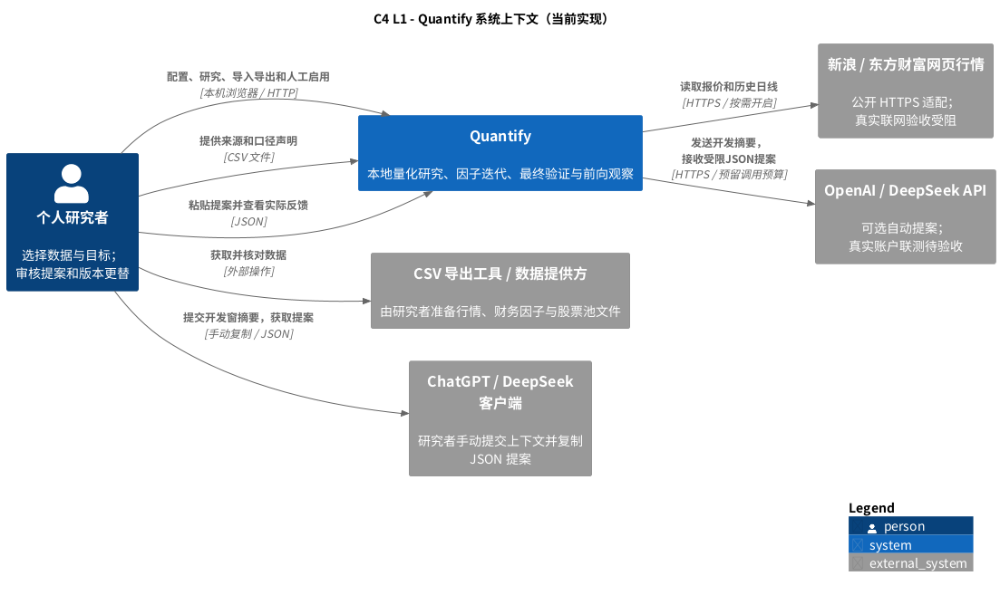
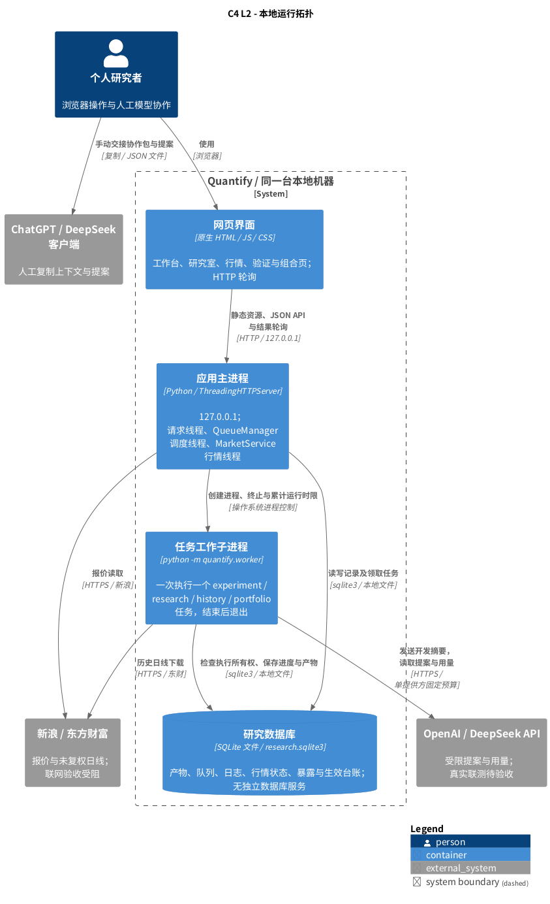

# Quantify 概要设计

- 文档版本：1.2
- 更新日期：2026-10-16（Asia/Shanghai）
- 实现基线：迭代 008 工作树，研究协议 `monthly-walk-forward-v3`；对应[构建计划](../BUILD_PLAN.md)（v9，组合账本基础）。本次设计文档不改变功能状态。
- 适用范围：个人本地量化研究、因子迭代、最终验收与研究版本观察。

## 1. 文档组织

| 文档 | 内容 |
| --- | --- |
| 本文 | 设计目标、C4 系统上下文与容器拓扑、部署和页面入口 |
| [模块架构](MODULES.md) | C4 组件视图、主要模块职责、数据关系、目标政策、任务状态与扩展点 |
| [关键流程](FLOWS.md) | 数据导入、在线数据、滚动实验、AI 迭代、最终验收、版本更替、前向观察及任务恢复 |
| [数据契约](../DATA_CONTRACTS.md) | CSV、时间、口径、快照与时点可用性细则 |
| [最终验证与研究版本](../VALIDATION_LIFECYCLE.md) | 冻结、暴露台账、人工更替和成熟标签操作规则 |

全文图表均采用 PlantUML。C4 图使用 PlantUML 自带标准库 `C4`；矩形表示逻辑运行单元或组件，不表示独立微服务。当前架构是模块化单体。

## 2. 设计目标与范围

研究主线为“数据快照 → 因子版本 → 开发实验 → AI 提案与反馈 → 冻结最终验收 → 人工更替 → 前向观察”。核心关注因子能否在相同口径和窗口下改善扣费后的上涨比例，同时保留平均收益、最差单笔收益和样本量。

| 设计目标 | 当前设计 |
| --- | --- |
| 可复现 | 绑定不可变快照/因子、评估参数、结构化目标、代码摘要及 Python 版本 |
| 防止前视 | 依赖历史可用输入；训练标签成熟后才择优；下一观察点入场 |
| 可证伪的迭代 | 所有候选、拒绝、失败及判定原因留档；AI 提案不能代替引擎结果 |
| 最终验证隔离 | 开发计算排除留出期；冻结后固定因子验收；暴露台账阻止重用区间获得独立资格 |
| 可控更替 | 独立验收后人工启用；替换/退役/回滚追加生效事件，保留历史信号 |
| 轻量本地运行 | Python 3.10+ 标准库、原生 HTML/JS/CSS、SQLite；生产运行无需第三方依赖 |

当前已经实现软件闭环中的手动操作和单笔研究基础。OpenAI与DeepSeek API已接入并通过离线协议/流程验证，真实API联测待凭据与网络。008已补开发窗组合资金/成交/净值账本，受限执行不代表真实可成交。以下能力仍属于规划：组合独立验收与启用、多因子版本引用及增量贡献、完整 IC/分组/相关性诊断、日线到月度信号/标签的自动串联、动态股票池及退市收益、真实公司行动与财务核验。

在线报价和日线适配已实现，但迭代 005 的真实联网复测仍被云代理拒绝；图中的连接表示代码调用路径，不表示来源覆盖、延迟或真实投资效果已验收。合成数据、价格收益和含分红总回报始终分别标识。不建设多用户、付费或券商交易系统。

## 3. C4 Level 1：系统上下文

研究者在本地浏览器中完成研究；CSV 文件由研究者提供，行情由本机服务读取。模型既可由研究者手动协作，也可在选定提供方和预算后，由工作子进程通过API取得提案。



外部模型不能访问本地数据库、最终验收或启用操作。API通路固定OpenAI Responses/DeepSeek Chat端点，密钥仅取环境变量；发送开发摘要前预留调用/token/估算费用预算。真实凭据、账户与联网验收状态见[模型API](../MODEL_API.md)。

## 4. C4 Level 2：容器与系统拓扑

这里的“容器”是 C4 的运行/存储单元概念，不要求 Docker。浏览器、应用进程、临时工作子进程和 SQLite 文件均位于同一台用户机器。



### 4.1 运行与部署约束

| 项目 | 当前约定 |
| --- | --- |
| 启动入口 | `python app.py --port 8000 --data-dir <目录>`；默认数据目录为 `runtime/`，可用 `QUANTIFY_DATA_DIR` 指定 |
| 网络监听 | 只监听 `127.0.0.1`，供本机浏览器使用 |
| 数据存储 | 各服务通过独立 SQLite 连接读写同一文件；不是每个模块一个数据库 |
| 队列 | 每个数据目录通过 `queue.lock` 保证一个 QueueManager；一次一个工作子进程，最多50个未结束任务 |
| 同步计算 | 旧分析、同步工作台操作、最终验收和前向更新受全局 `WORK` 请求信号量保护；释放后才发送响应 |
| 并发边界 | 请求信号量与后台队列相互独立，不是全系统单一计算锁；SQLite 事务保护关键写入 |
| 外网 | 在线适配器及选定的模型提供方按需访问固定HTTPS目标；报价/下载默认关闭，模型默认手动模式 |
| 停机与恢复 | 正常退出停止行情/队列线程及当前子进程；启动时排队/运行任务转为 interrupted，不自动重跑 |
| 备份 | 停止程序后备份整个数据目录，包含产物和暴露、生效、幂等台账；运行数据不入 Git |

工作子进程提供停止和运行时间控制，不是执行任意模型代码的安全沙箱。模型产出的公式通过受限 AST 解释器计算，不使用 `eval/exec`。

### 4.2 页面和 API 入口

| 页面 | 当前能力 | 主要 API |
| --- | --- | --- |
| `/` 个股与演示 | 合成基本面、估值情景、GBM 风险、旧版简化研究和导出 | `/api/stocks`、`/api/analyze`、`/api/research` |
| `/workspace` 研究工作台 | CSV/快照、时点查询、日线转月度、因子版本、实验比较/复现 | `/api/workspace/*`；页面实验走 `/api/lab/experiments` |
| `/lab` AI 研究室 | 手动/双提供方API、模型配置、预算、任务控制、逐轮反馈 | `/api/lab/*` |
| `/market` 在线数据 | 自选股报价、缓存/失败提示、历史下载及每日调度设置 | `/api/market/*` |
| `/portfolio` 组合回放 | 固定因子开发窗双账本、费用/执行、净值/回撤、导出与复现 | `/api/portfolio/*`，任务控制复用 `/api/lab/*` |
| `/strategies` 验证与版本 | 冻结、最终验收、人工启用/替换/退役/回滚、月度信号与观察 | `/api/strategies/*` |

## 5. 架构决策与扩展顺序

| 决策 | 原因 | 后续扩展约束 |
| --- | --- | --- |
| 模块化单体与本地 SQLite | 单人低频研究，便于部署和审计 | 数据量扩大后再评估列式存储或独立任务服务 |
| 不可变研究产物 + 可变运行状态 | 避免修订覆盖旧结论，同时支持队列与缓存 | 更替追加事件；不得覆盖既有实验或因子 |
| 计算函数与外部数据/模型解耦 | 防止供应商或模型控制评估口径 | 新适配器必须符合时间、口径和预算契约 |
| 默认上涨比例主目标 + 收益/尾部约束 | 对齐研究目标，避免只优化一个数字 | 调整目标须显式配置，旧实验不能直接混比 |
| 开发、最终验收和前向观察分开 | 控制反复择优和事后记录偏差 | 新最终区间必须未暴露；前向入场晚于实际信号生成日 |
| 研究版本先人工更替 | 让启用理由和生效历史可核查 | 自动更替依赖更充分数据、诊断与组合引擎，当前不启用 |

具体研发状态以[构建计划](../BUILD_PLAN.md)和[迭代记录](../iterations/README.md)为准；本设计不把规划接口视为已完成组件。

## 6. PlantUML 预览与验证

Markdown 中的 `plantuml` 代码块为图表源文件。支持 PlantUML 的编辑器可以直接预览；普通 Markdown 渲染器可能只显示代码。

本轮使用 **PlantUML 1.2025.4、Java 及 Graphviz** 做渲染校验；C4 使用该版本 JAR 内的标准库，图表不通过远程 `!includeurl` 加载，也不提交到公共渲染站点。Java、PlantUML、Graphviz 仅供文档工具使用，不是应用运行依赖。

在仓库根目录可导出图源，或通过本地 JAR 同时渲染 SVG：

```bash
# 默认仅提取到已忽略的 runtime/design/，不修改 Markdown
python docs/design/render_diagrams.py

# 使用本机已有的 PlantUML JAR，提取并渲染
python docs/design/render_diagrams.py --jar /path/to/plantuml-1.2025.4.jar

# 自定义输出目录，避免把生成物加入版本库
python docs/design/render_diagrams.py --out /tmp/quantify-design --jar /path/to/plantuml-1.2025.4.jar
```

当前共有18幅图。修改图表只编辑 Markdown 代码块，再重新导出；生成的 `.puml` / `.svg` 不作为第二份手工维护的源文件。组合扩展与本轮验证见[迭代008](../iterations/008-portfolio-ledger/README.md)，原文档建立记录见[迭代 006](../iterations/006-outline-design/README.md)。
